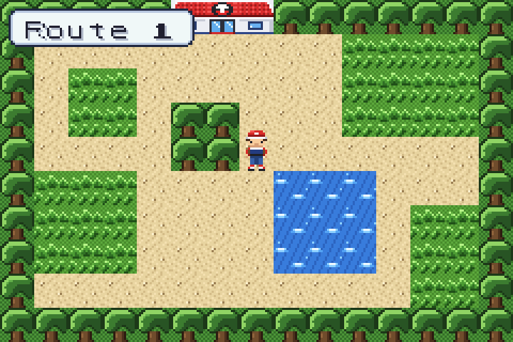
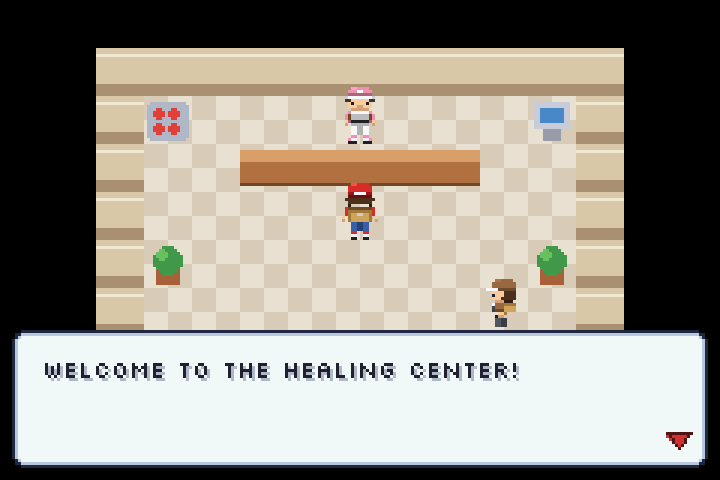
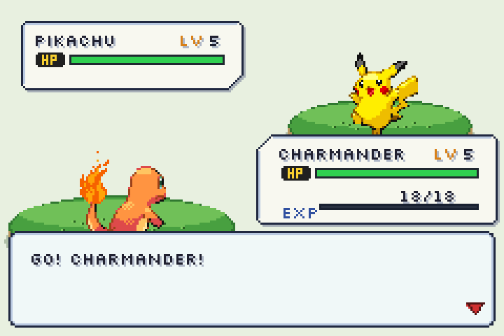
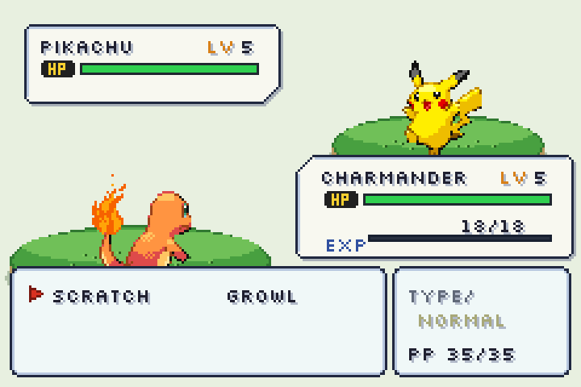
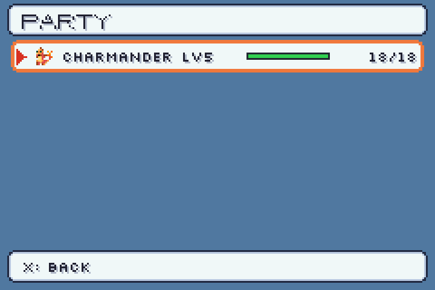
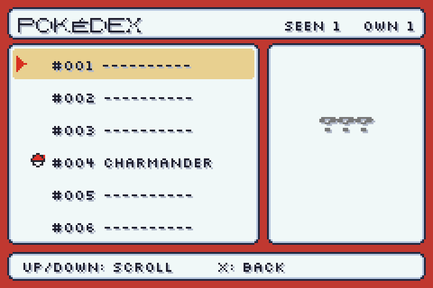

# 🎮 Creature Collector (GBA style)

A small turn-based creature-collecting RPG in **Python + Pygame**, styled after Game Boy Advance games and built as an **object-oriented programming** project.


**📘 The OOP write-up — the four pillars mapped to exact lines, design patterns and UML diagrams — is in [docs/OOP.md](docs/OOP.md).**

---

## What you can do in the demo

1. **Title screen:** start a NEW GAME or CONTINUE a save.
2. **Professor's intro:** PROF. CEDAR welcomes you and you type your name.
3. **Choose a starter** from three balls in the lab (Fire, Water or Grass). Your rival JUNO takes the one that's strong against yours.
4. **Explore four connected areas:**
   - Fernvale Town
   - Route 1, with tall grass and wild creatures
   - Brookhaven City, with a Healing Center you can walk into
   - Brookhaven Gym
5. **Battle:**
   - Wild creatures: fight, catch, run or switch.
   - Trainers who spot you in their line of sight.
   - Your rival.
   - Gym Leader WREN, for the GALE BADGE.
6. **GBA-style animations:**
   - battle-start transitions (sweeping bars for wild battles, a closing circle for trainers)
   - creatures slide in and pop out of their ball
   - a move effect per type: embers, bubbles, leaves, lightning, quakes, gusts and more
   - hits flicker, fainted creatures drop away
   - the ball arcs, wobbles once per shake check, and clicks shut or bursts open
   - level-up glow, status sparkles, stat arrows
7. **Grow your team:** level-ups, new moves (choose one to forget when you already know 4), and evolution with an animated sequence.
8. **Manage everything:**
   - Party screen
   - Pokédex
   - Bag (use items on a chosen creature)
   - Trainer card with your badges
   - Save to disk

| | |
|---|---|
|  |  |
|  |  |
|  |  |

---

## Running it

```bash
pip install -r requirements.txt
python3 main.py              # the game (240×160, scaled 3× to 720×480)
python3 terminal_demo.py     # text-only battle prototype
```

### Controls

| Key | Overworld | Menus and battles |
|---|---|---|
| Arrows / WASD | walk (hold to keep walking) | move the cursor |
| Z / Space | talk, read signs | confirm, advance text |
| Enter / Esc | open the pause menu | confirm (Enter) / back (Esc) |
| X | — | back / cancel |
| F11 | toggle fullscreen | |

---

## How it's built

```
creature-collector/
├── main.py                 launcher (starts at the title screen)
├── terminal_demo.py        text-only battle prototype
├── data/                   all game content as JSON
│   ├── creatures.json      species, stats, learnsets, evolutions
│   ├── moves.json  items.json  type_chart.json  encounters.json
│   ├── maps/*.json         every map: rows of tiles, warps, people, signs, trainers
│   └── world.json          where a new game starts
├── src/
│   ├── model/              game rules — never imports pygame
│   │   ├── creature.py move.py move_effect.py status.py item.py bag.py
│   │   ├── battle.py battle_ai.py events.py type_chart.py
│   │   ├── trainer.py pokedex.py badges.py story.py game_state.py
│   │   └── world.py entities.py direction.py
│   ├── ui/                 screens (pygame): one Scene subclass per screen
│   ├── data_loader.py      builds model objects from data/ (factories)
│   └── save_manager.py     JSON save files
├── tests/                  164 tests, run headless
├── scripts/capture_stages.py   regenerates the screenshots above
└── docs/
    ├── OOP.md              the OOP design write-up with UML
    └── PLAN.md             review findings and build log, phase by phase
```

Key rules the code follows:
- **`src/model/` has zero pygame imports.** A test enforces this. The screens ask the model to do things and animate what it reports back; for example, `Battle` returns a list of `BattleEvent`s.
- **Content is data.** To add a creature, edit `creatures.json`. To redesign a map, edit its rows in `data/maps/`. No class hard-codes game content.
- **Every bug fixed has a test** (`tests/test_bug_regressions.py`), and every screen is checked for text that overflows its box.

---

## Tests

```bash
python3 -m unittest discover tests        # 164 tests, about 1 second, no window needed
python3 scripts/capture_stages.py          # refresh screenshots/
```

---

## Credits

Code written for a college OOP course. The creature sprites, names and fonts come from existing assets and are used for a private classroom project only; they are not covered by any licence for this code.
