# Creature Collector — Object-Oriented Design

A small GBA-style creature-collecting game in Python and Pygame, built as an OOP project.
This document maps the course's object-oriented concepts to the exact classes and lines that demonstrate them:
- classes and objects
- the four pillars
- association, aggregation and composition
- SOLID
- design patterns
- exception handling
- UML use-case, class, sequence, activity and state diagrams

Every reference below is a link to the line in the source.

---

## 1. Architecture at a glance

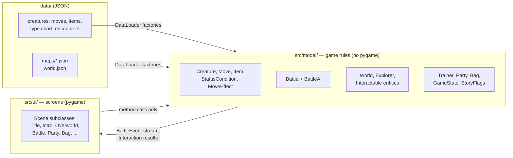

* **`src/model/`** holds every rule of the game and never imports pygame. A test enforces this:
  [test_model_layer_has_zero_pygame_imports](../tests/test_scene_rendering.py#L48).
* **`src/ui/`** only draws and handles input. It asks the model to do things and animates what the model reports back.
* **`data/`** holds the content: species, moves, items, the type chart, encounter tables and maps. Nothing is hard-coded in classes; `DataLoader` builds objects through factories.

### Classes, objects and constructors

| Concept | Example |
|---|---|
| Classes | 152 in total: 80 in the game rules (`src/model/`), 15 in networking (`src/net/`), the rest in the screens (including the 32-class animation and transition hierarchies) |
| Objects | every creature, move, item, trainer, map and battle is an object built from data at runtime, e.g. [DataLoader.get_creature()](../src/data_loader.py#L116) |
| Constructors that enforce valid objects | [Creature.__init__](../src/model/creature.py#L51) clamps the level and HP; [Party.__init__](../src/model/trainer.py#L44) refuses more than 6 creatures |
| Constructor chaining | [TrainerBattle.__init__](../src/model/battle.py#L517) calls `super().__init__()`, and `GymBattle` chains onto that |
| Class vs instance attributes | `Party.MAX_PARTY_SIZE` and `Creature._uid_counter` belong to the class; `_hp` and `_level` belong to each object |
| Class methods and static methods | 30 in the model, e.g. the alternative constructors `GameState.from_dict()` and `Location.from_dict()` |
| Properties (read-only attributes) | 132 `@property` getters in the model; see Encapsulation below |

---

## 2. Encapsulation

> Each object keeps its state private and exposes it read-only. State changes only through methods that enforce the rules.

| Class | Private state | Only changed through | Rule enforced |
|---|---|---|---|
| `Creature` | `_hp`, `_level`, `_xp`, `_moves`, `_status`, `_stat_stages` ([constructor](../src/model/creature.py#L56)) | [take_damage()](../src/model/creature.py#L228), [heal()](../src/model/creature.py#L236), [gain_xp()](../src/model/creature.py#L282), [learn_move()](../src/model/creature.py#L306), [apply_status()](../src/model/creature.py#L263) | HP stays between 0 and max; fainted creatures can't be healed, only revived; at most 4 moves; type immunities |
| `Move` | `_current_pp` | [use()](../src/model/move.py#L86), [restore_pp()](../src/model/move.py#L93) | PP never below 0 or above max |
| `Item` | `_quantity` | [consume()](../src/model/item.py#L89), [add_stock()](../src/model/item.py#L84) | stock can't go negative |
| `Bag` | `_items` dict | [add()](../src/model/bag.py#L30), [use()](../src/model/bag.py#L65) | stacks merge by id; empty stacks disappear |
| `Party` | `_creatures` list, exposed as a tuple ([creatures](../src/model/trainer.py#L17)) | [add()](../src/model/trainer.py#L51), [swap()](../src/model/trainer.py#L64) | at most 6 creatures |
| `Trainer` | `_money`, `_party`, `_bag`, `_pc` | [spend()](../src/model/trainer.py#L151), [earn()](../src/model/trainer.py#L148), [receive_creature()](../src/model/trainer.py#L165) | can't overspend; a full party sends new catches to the PC |
| `Pokedex` | `_seen`, `_caught` sets, exposed as frozensets | [register_caught()](../src/model/pokedex.py#L35) | catching also marks a species as seen |
| `Battle` | `_state`, `_active`, `_opponent` | [execute_move()](../src/model/battle.py#L152), [use_item()](../src/model/battle.py#L180), [switch_creature()](../src/model/battle.py#L255) | the turn order and faint rules can't be bypassed |

Proof in tests: [TestEncapsulation](../tests/test_oop_pillars.py#L27) checks, for example, that `creature.current_hp = 999` raises `AttributeError`.

---

## 3. Abstraction

> Abstract base classes define *what* something does; subclasses decide *how*. Callers depend only on the abstract interface.

| Abstract class | Abstract methods / hooks | Concrete subclasses |
|---|---|---|
| [Move](../src/model/move.py#L19) | `is_damaging()` | `PhysicalMove`, `SpecialMove`, `StatusMove` |
| [DamagingMove](../src/model/move.py#L123) | `attack_stat()`, `defense_stat()` | `PhysicalMove`, `SpecialMove` |
| [Item](../src/model/item.py#L23) | `can_use()`, `_apply()` | `HealingItem`, `StatusCureItem`, `ReviveItem`, `CatchBall` |
| [StatusCondition](../src/model/status.py#L16) | `applied_message()` (+ overridable `before_move`, `on_turn_end`, `modify_speed`) | `Burn`, `Poison`, `Paralysis`, `Sleep` |
| [MoveEffect](../src/model/move_effect.py#L18) | `apply()` (+ overridable `ai_score`) | `InflictStatus`, `HealUser`, `ChangeStat` |
| [Battle](../src/model/battle.py#L54) | `can_flee`, `can_catch`, `intro_message`, `_on_opponent_fainted()` | `WildBattle`, `TrainerBattle`, `GymBattle` |
| [BattleAI](../src/model/battle_ai.py#L15) | `_pick()` | `RandomAI`, `SmartAI` |
| [Interactable](../src/model/entities.py#L44) | `interact()`, `_from_data()` | `Sign`, `StarterBall`, `ItemBall`, `NPC`, `Healer`, `Professor`, `GiftGiver`, `Shopkeeper`, `TrainerNPC`, `RivalTrainer`, `GymLeader` |
| [Scene](../src/ui/scene.py#L6) | `handle_event()`, `update()`, `draw()` | `TitleScene`, `IntroScene`, `OverworldScene`, `BattleScene`, `EvolutionScene`, `PartyScene`, `PokedexScene`, `BagScene`, `CardScene` |

Two larger abstractions hide whole subsystems:

* **`Battle`** hides the turn rules (speed order, accuracy, critical hits, status, faints, XP) behind a few calls such as `execute_move(i)`. It never draws anything. It returns immutable [BattleEvent](../src/model/events.py#L50) objects that the battle screen plays back.
* **`Explorer`** ([world.py](../src/model/world.py#L217)) hides the world rules: what blocks you, where doors lead, who is in front of you, whether a trainer sees you, and whether a wild creature appears. The overworld screen only animates the result.

Proof in tests: [TestAbstraction](../tests/test_oop_pillars.py#L82) checks that the abstract classes can't be instantiated.

---

## 4. Inheritance

> Subclasses reuse the parent's code and extend or specialise it, often calling `super()`.

```text
Move ─────────────┬─ DamagingMove ─┬─ PhysicalMove
                  │                └─ SpecialMove
                  └─ StatusMove
Item ─────────────┬─ HealingItem ─ StatusCureItem ─ ReviveItem ─ CatchBall
StatusCondition ──┬─ _ChipDamageStatus ─┬─ Burn
                  │                     └─ Poison
                  ├─ Paralysis
                  └─ Sleep
MoveEffect ───────┬─ InflictStatus ─ HealUser ─ ChangeStat
Battle ───────────┬─ WildBattle
                  ├─ TrainerBattle ── GymBattle
                  └─ LinkBattle      two people choose; no AI
Connection ───────┬─ SocketConnection (Wi-Fi)
                  └─ MemoryConnection (tests)
LinkSession ──────┬─ HostSession     runs the LinkBattle
                  └─ GuestSession    plays back the host's events
BattleAI ─────────┬─ RandomAI ─ SmartAI
Interactable ─────┬─ Sign
                  ├─ StarterBall
                  ├─ ItemBall        picked up once, then gone
                  └─ Character ── NPC ─┬─ Healer         (the nurse, and MOM at home)
                                       ├─ Professor
                                       ├─ GiftGiver      gives items once
                                       ├─ Shopkeeper     opens the shop
                                       └─ TrainerNPC ─┬─ RivalTrainer
                                                      └─ GymLeader
_CreatureCollection ─┬─ Party
                     └─ PCBox
Scene ────────────── one subclass per screen (title, overworld, battle, bag, shop, ...)
Animation ────────┬─ SlideIn, SendOut, HitBlink, FaintDrop, ScreenShake, BallThrow, BallWobble, ...
                  └─ MoveAnimation ─┬─ ImpactAnimation, ThunderAnimation, QuakeAnimation, GustAnimation, ...
                                    └─ ProjectileAnimation ─ EmberAnimation, WaterAnimation, LeafAnimation, ...
Transition ───────┬─ WildTransition
                  └─ TrainerTransition
```

Examples of reuse and extension:

* **Shared code in a middle class.** [_ChipDamageStatus](../src/model/status.py#L81) implements "lose 1/16 HP each turn" once, and `Burn` and `Poison` inherit it. [_CreatureCollection](../src/model/trainer.py#L10) gives `Party` and `PCBox` the same read-only view and iteration.
* **Extending with `super()`.**
  * [Healer.interact()](../src/model/entities.py#L252) reuses the NPC greeting, then heals the party.
  * [TrainerBattle.__init__](../src/model/battle.py#L517) reuses all of `Battle`'s setup and adds the trainer's reserve team.
  * [RivalTrainer._party_spec()](../src/model/entities.py#L467) adds the rival's starter to the trainer's normal team.
* **Three levels deep.** `GymBattle` → `TrainerBattle` → `Battle`. `GymBattle` only overrides [_victory_extras()](../src/model/battle.py#L583) to add a badge; everything else (turns, prize money, sending out the next creature) is inherited.

Proof in tests: [TestInheritance](../tests/test_oop_pillars.py#L91), [test_trainers.test_hierarchy](../tests/test_trainers.py#L61) and [test_world.test_hierarchy](../tests/test_world.py#L108).

---

## 5. Polymorphism

> The caller makes one call, and each class responds in its own way. The engine never asks "what kind of object is this?"

| Call site | One call… | …different behaviour per class |
|---|---|---|
| [DamageCalculator.calculate](../src/model/damage.py#L46) | `move.attack_stat(user)` | `PhysicalMove` uses Attack, `SpecialMove` uses Sp. Atk |
| [Battle._execute_move_step](../src/model/battle.py#L357) | `status.before_move()` | `Paralysis` may skip the turn, `Sleep` counts down then wakes up, `Burn` does nothing |
| [Battle._end_of_turn](../src/model/battle.py#L410) | `status.on_turn_end()` | `Burn`/`Poison` deal damage, the others don't |
| [Battle._execute_move_step](../src/model/battle.py#L391) | `effect.apply()` | inflict a status, heal the user, or change a stat |
| [Battle.use_item](../src/model/battle.py#L189) | `item.use_in_battle(battle)` | potions heal your creature; [CatchBall](../src/model/item.py#L210) overrides it to throw itself at the opponent |
| [Battle.execute_move](../src/model/battle.py#L165) | `ai.choose_move()` | `RandomAI` picks any move; `SmartAI` scores them with the type chart |
| [SmartAI.score](../src/model/battle_ai.py#L55) | `effect.ai_score()` | a heal is worth more when hurt; a status is worthless on an already-afflicted target |
| [Battle._resolve_faints](../src/model/battle.py#L427) | `self._on_opponent_fainted()` | `WildBattle` ends the battle; `TrainerBattle` sends out the next creature or pays the prize |
| [Explorer.interact](../src/model/world.py#L288) | `entity.interact(state, facing)` | a sign shows text, an NPC turns and talks, the healer heals, the professor gives a gift, a starter ball offers its creature, a trainer starts a battle |
| [Explorer.spotted_by](../src/model/world.py#L294) | `entity.notices(...)` | `False` for everything except `TrainerNPC`, which checks its line of sight |
| [OverworldScene._start_trainer_battle](../src/ui/overworld_scene.py#L332) | `trainer.build_battle(...)` | `TrainerNPC` → `TrainerBattle` + `RandomAI`; `GymLeader` → `GymBattle` + `SmartAI`; `RivalTrainer` → its starter-led team |
| [BagScene](../src/ui/bag_scene.py#L80) | `item.usable_in_field` | `True` for potions; `CatchBall` overrides it to `False` |
| `engine.current_scene.update() / draw()` | `scene.draw(surface)` | each screen draws itself |
| [LinkBattleScene._submit](../src/ui/link_scene.py#L196) | `session.submit(action)` / `session.poll()` | `HostSession` resolves the turn itself; `GuestSession` sends the choice over the network and plays back what comes back. `LinkBattleScene` (a `BattleScene` subclass) never knows which it has |
| [LinkSession._send](../src/net/session.py#L64) | `connection.send(message)` | `SocketConnection` writes to Wi-Fi; `MemoryConnection` hands it to the other player in the same process (tests) |
| [BattleScene._mods](../src/ui/battle_scene.py#L392) | `anim.modify(side, mods)` / `anim.draw()` | a hit flickers the target, a faint drops it, a send-out grows it from a white silhouette, a ball hides it |
| [MoveAnimation.create](../src/ui/animations.py#L361) | `MoveAnimation.create(type, category, side)` | a self-registering class per move type: Fire embers, Water bubbles, Grass leaves, an Electric bolt, a Ground quake... |
| [Transition.draw](../src/ui/transitions.py#L31) | `transition.cover(surface, p)` | wild battles close with sweeping bars, trainer battles with a shrinking circle |

Proof in tests: [TestPolymorphism](../tests/test_oop_pillars.py#L114).

---

## 6. Design patterns used

| Pattern | Where |
|---|---|
| **Factory** | [MoveFactory](../src/model/move.py#L168), [ItemFactory](../src/model/item.py#L213), [CreatureFactory](../src/model/creature.py#L371), `DataLoader` |
| **Self-registering factory** (`__init_subclass__`) | [Interactable.from_data()](../src/model/entities.py#L54) and [StatusCondition.create()](../src/model/status.py#L28): a new subclass registers itself just by being defined |
| **Factory Method** | [TrainerNPC.build_battle()](../src/model/entities.py#L429) with the overridable `_battle_class()`, `_make_ai()` and `_party_spec()` |
| **Template Method** | [Item.use()](../src/model/item.py#L111) (check → consume → `_apply()`); `Battle`'s turn calls the hooks `_on_opponent_fainted()`, `_xp_multiplier` and `_victory_extras()` |
| **Strategy** | `BattleAI` (`RandomAI` / `SmartAI`) plugged into a `Battle` |
| **State** | [BattleState](../src/model/battle.py#L41) enum; every screen's `mode` / `sub_state` |
| **Command** | [LinkAction](../src/model/link_battle.py#L43): each player's choice is an object that can be sent over the network and resolved later |
| **Proxy** | `GuestView` stands in for the real battle on the guest's computer, updated from the host's events |
| **Observer-like event stream** | `Battle` returns `BattleEvent`s; `BattleScene` plays them back without knowing the rules |
| **Composition** | `GameState` *has* a `Trainer`, `Pokedex`, `StoryFlags`, `BadgeCase`; `Trainer` *has* a `Party`, `Bag` and `PCBox`; `Party` *has* `Creature`s, which *have* `Move`s and a `StatusCondition` |

---

## 7. Relationships between classes

| Relationship | Meaning | Examples in the code |
|---|---|---|
| **Association** (uses / knows about) | one object holds a reference to another it didn't create and doesn't own | `Battle` → `Trainer` (the player); `Explorer` → `World`; `OverworldScene` → `GameEngine` |
| **Dependency** (uses temporarily) | used as a parameter or return value only | `Item.use_in_battle(battle)`; `TrainerNPC.build_battle(...)` *creates* a `TrainerBattle`; `Battle` *creates* `BattleEvent`s |
| **Aggregation** (has-a, parts can live on their own) | the container holds parts that exist independently and can move elsewhere | `Party` ◇— `Creature` (a creature moves between the party and the `PCBox`, and a caught wild creature already existed before it joined); `Bag` ◇— `Item`; `Battle` ◇— `BattleAI` (passed in from outside) |
| **Composition** (owns, parts live and die with it) | the whole creates and owns its parts | `GameState` ◆— `Trainer`, `Pokedex`, `StoryFlags`, `BadgeCase`; `Trainer` ◆— `Party`, `Bag`, `PCBox` (created in its constructor); `World` ◆— `WorldMap` ◆— `Warp`; `Creature` ◆— its `Move`s |
| **Inheritance** (is-a) | see section 4 | `GymBattle` is a `TrainerBattle` is a `Battle` |
| **Realisation** (implements an abstract interface) | a concrete class implements every abstract method | `PhysicalMove` realises `DamagingMove`; `RandomAI` realises `BattleAI` |

The class diagrams in section 10 draw these with the standard UML arrows: `*--` composition, `o--` aggregation, `-->` association, `..>` dependency and `<|--` inheritance.

---

## 8. SOLID principles

| Principle | How the project follows it | Honest caveats |
|---|---|---|
| **S** — Single Responsibility | Each class has one job. Examples: [DamageCalculator](../src/model/damage.py#L33) only computes damage; `Bag` only manages items; [Shop](../src/model/shop.py#L26) only handles buying and selling (`ShopScene` only draws it); `SaveManager` only reads and writes files; `Explorer` only applies movement rules; `MapRenderer` only draws maps. The model/UI split keeps rules and drawing apart. | `battle.py` is still the largest model file (about 590 lines), because it holds three classes and the full turn logic. `OverworldScene` (about 520 lines) coordinates walking, dialogue, menus, starters and trainer encounters. Each could be split further, e.g. a `TurnResolver` and a `DialogueController`. |
| **O** — Open/Closed | New behaviour is added by **adding a subclass**, not editing existing code. A new status, entity or item type registers itself (the shop clerk, item balls and gift givers were added this way, with no change to `Explorer`) and works in battles, maps and the bag without touching `Battle`, `Explorer` or `BagScene` ([registry](../src/model/entities.py#L54)). | Adding a new tile kind still means adding a line to `TILE_KINDS` and a painter in `TileArt`. |
| **L** — Liskov Substitution | Anywhere a parent is expected, a subclass works: the overworld runs `WildBattle`, `TrainerBattle` and `GymBattle` through the same `BattleScene`; `Battle` accepts any `BattleAI`; `Explorer.interact()` accepts any `Interactable`. Subclasses never strengthen preconditions. For example, `TrainerBattle.attempt_run()` returns an "invalid action" event rather than raising, just as `Battle` does. | — |
| **I** — Interface Segregation | The abstract classes are small and focused: `BattleAI` needs only `_pick()`; `MoveEffect` needs only `apply()`; `Interactable` needs only `interact()`. Optional abilities such as `notices()`, `is_present()` and `ai_score()` have safe defaults, so subclasses only override what they use. | Python has no separate `interface` keyword; abstract base classes play that role. |
| **D** — Dependency Inversion | High-level code depends on abstractions, and the concrete pieces are injected: `Battle` receives a `BattleAI` and a `move_source` function; `TrainerNPC.build_battle()` receives a `creature_factory` function; `Shop` receives an `item_source` function instead of reading the data files itself; `DamageCalculator` and `OverworldScene` accept an injectable random source (which is how the tests make battles predictable). | `GameEngine` still creates its own `DataLoader`. |

---

## 9. Exception handling

The game defines its own exception hierarchy in [errors.py](../src/model/errors.py#L18):

```text
GameError
├── GameDataError (also ValueError)      bad content in data/*.json
│   └── UnknownIdError (also KeyError)   an id that isn't in the data
├── RuleViolation (also ValueError)      code tried to break a game rule
└── SaveError
    ├── SaveNotFoundError (also FileNotFoundError)
    ├── CorruptSaveError                 file exists but can't be loaded
    └── SaveWriteError (also OSError)    couldn't write to disk
```

| Practice | Where |
|---|---|
| **Specific exceptions, raised where the problem is detected** | `UnknownIdError` in [DataLoader](../src/data_loader.py#L101); `RuleViolation` in `Party`, `Item` and `Trainer`; `GameDataError` while parsing maps |
| **Translating low-level errors into meaningful ones, keeping the cause** (`raise ... from e`) | [SaveManager.load_game()](../src/save_manager.py#L64) turns `JSONDecodeError`, `KeyError` and unknown ids into `CorruptSaveError` |
| **No silent data loss** | [GameState](../src/model/game_state.py#L89) reports an unknown species in a save instead of quietly dropping that creature |
| **Safe writes** (`try` / `except` / `finally`) | [SaveManager.save_game()](../src/save_manager.py#L41) writes to a temporary file and swaps it in only on success; `finally` removes the temp file, so a failed save never damages the old one |
| **Catching only what you expect, at the right layer** | the title screen catches `SaveError` and shows "Your save file is damaged"; the overworld catches `SaveError` and shows "Save failed!"; font and sprite loading catch only `pygame.error` / `OSError` and fall back to built-in art. There is no bare `except:` or `except Exception` anywhere. |
| **Invalid player actions are not exceptions** | choosing a move with no PP or running from a trainer returns an `INVALID_ACTION` event, because these are normal game situations rather than errors |
| **Validation at construction** | `WorldMap` rejects uneven rows and unknown tiles; `TrainerBattle` rejects an empty team |

Proof in tests: [tests/test_errors.py](../tests/test_errors.py#L28) checks:
- missing, non-JSON and newer-version saves
- unknown species in a save
- a simulated "disk full" that must leave the old save intact
- the title and overworld screens reporting problems to the player

---

## 10. UML diagrams

### 10.1 Class diagram — battles

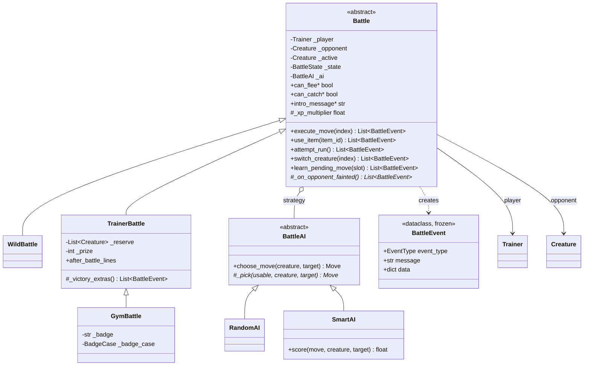

### 10.2 Class diagram — creatures, moves, effects, statuses and items

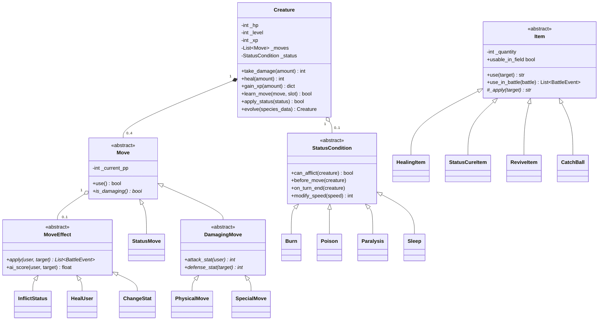

### 10.3 Class diagram — world and map entities

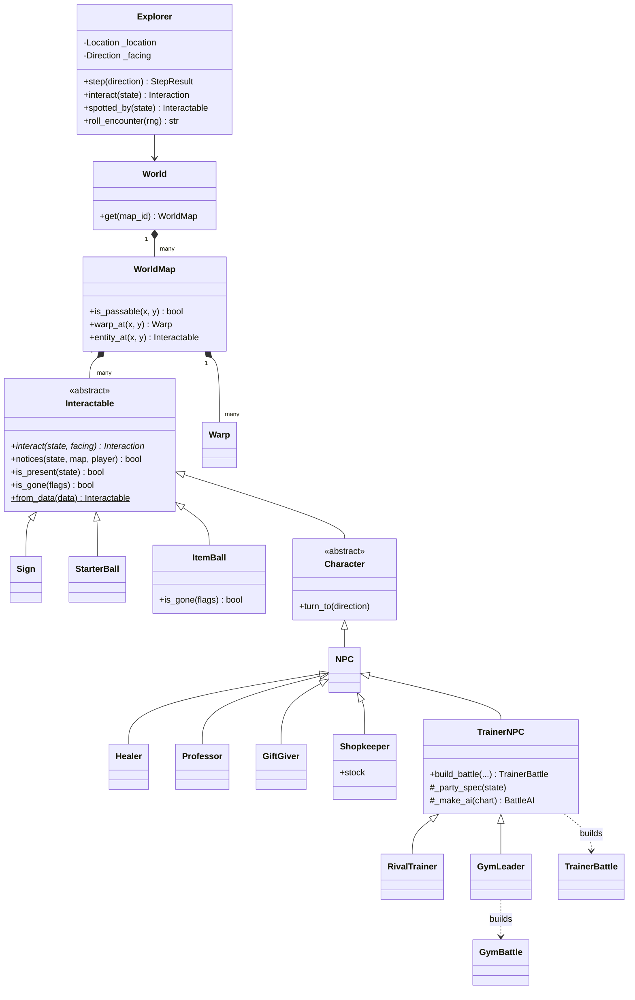

### 10.4 Class diagram — player state (composition)

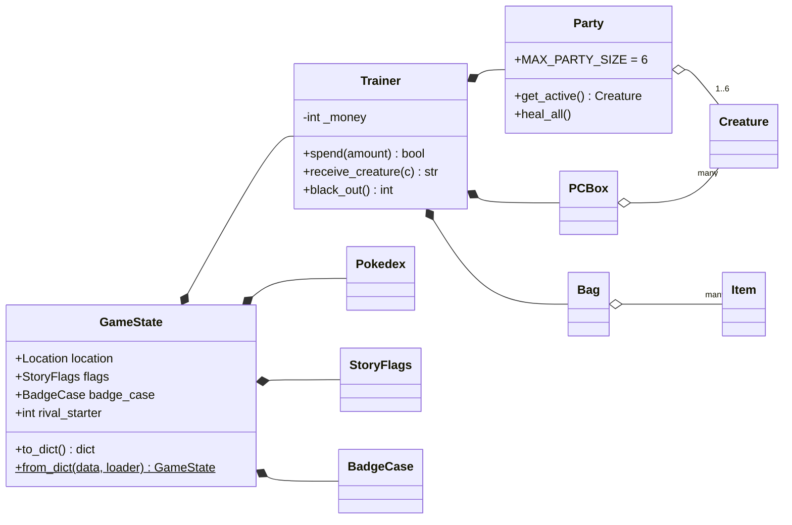

### 10.5 Use-case diagram

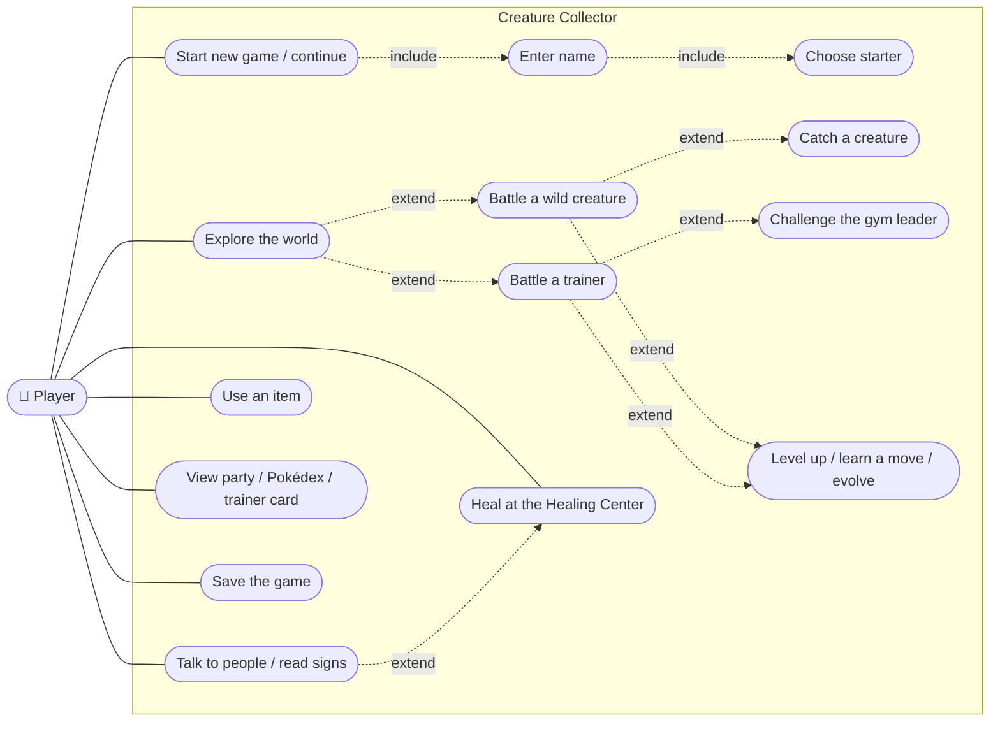

*Mermaid has no dedicated use-case diagram, so this uses a flowchart: ovals are use cases, dotted arrows are «include» / «extend».*

### 10.6 Sequence diagram — one battle turn (player uses a move)

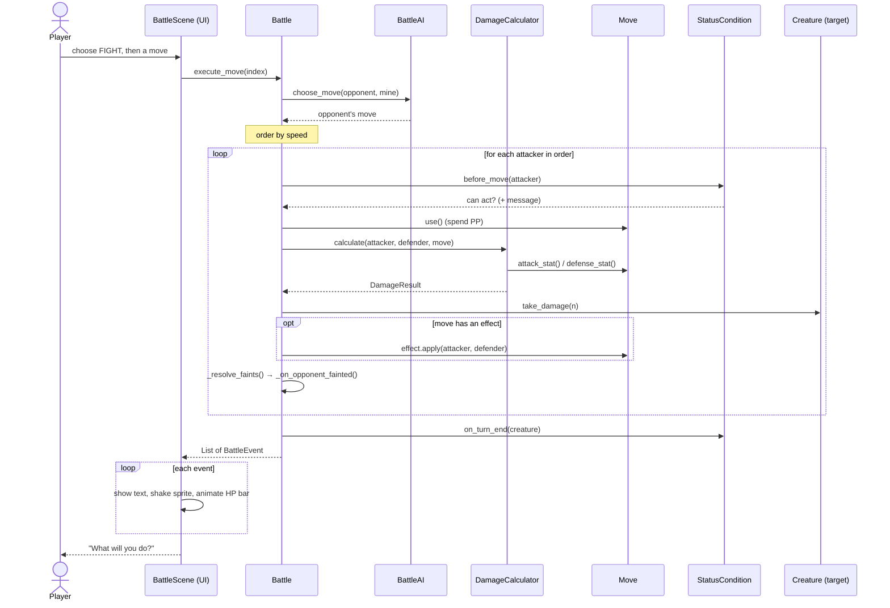

### 10.7 Sequence diagram — choosing a starter

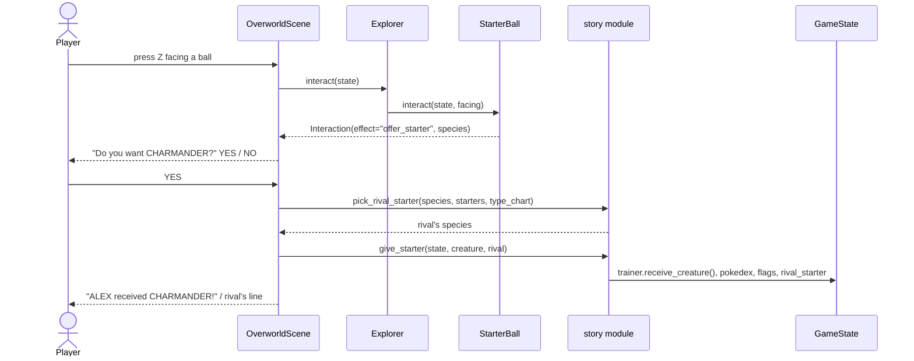

### 10.8 Activity diagram — playing the demo

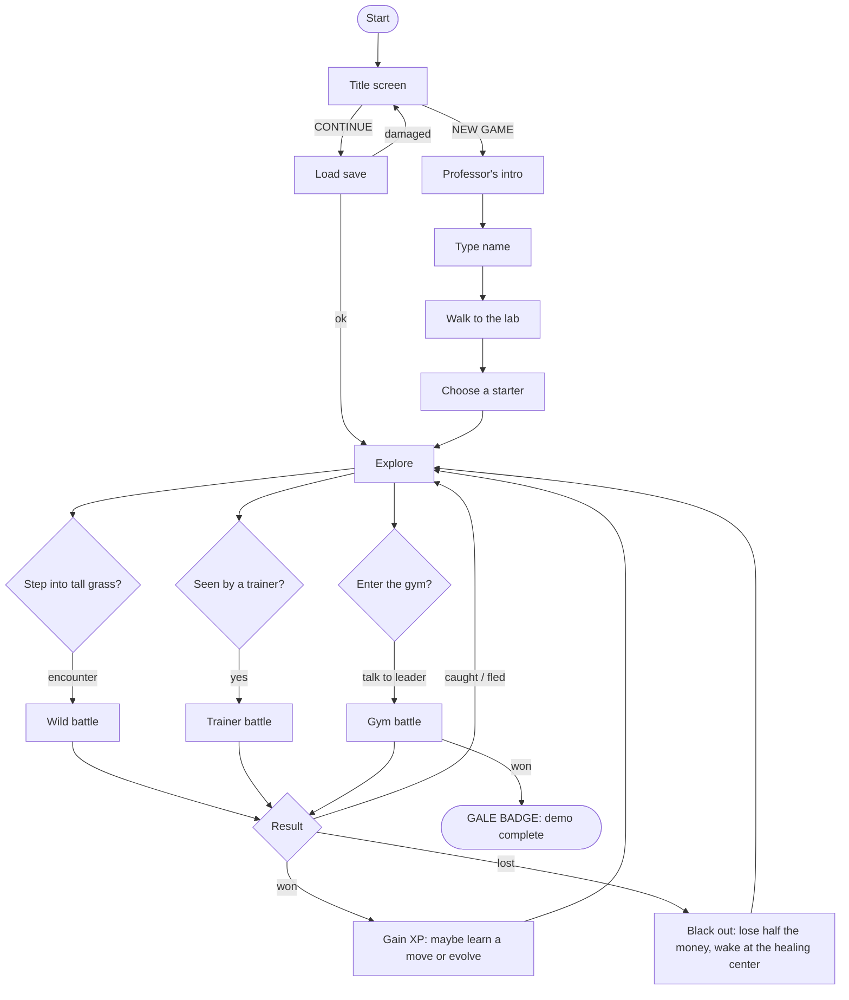

### 10.9 Activity diagram — one battle turn

```mermaid
flowchart TD
    S([Player picks an action]) --> A{Which action?}
    A -->|FIGHT| B[Opponent AI picks a move]
    B --> C[Order by speed]
    C --> D[Next attacker]
    D --> E{Status lets it act?}
    E -->|no| N
    E -->|yes| F[Spend PP, roll accuracy]
    F -->|miss| N
    F -->|hit| G[Calculate and deal damage]
    G --> H[Apply move effect?]
    H --> I{Anyone fainted?}
    I -->|opponent| J{Trainer has more creatures?}
    J -->|yes| K[Send out next] --> N
    J -->|no| WIN([Won: XP, prize, badge])
    I -->|player's creature| P{Any creature left?}
    P -->|yes| SW([Choose next creature])
    P -->|no| LOSE([Lost: black out])
    I -->|no| N{Both have moved?}
    N -->|no| D
    N -->|yes| O[End of turn: burn / poison damage] --> S
    A -->|BAG| Q[Item.use_in_battle] --> FREE[Opponent attacks] --> S
    A -->|SWITCH| R[Swap creature] --> FREE
    A -->|RUN| U{can_flee and lucky?}
    U -->|yes| FLED([Fled])
    U -->|no| FREE
```

### 10.10 State diagram — battle states

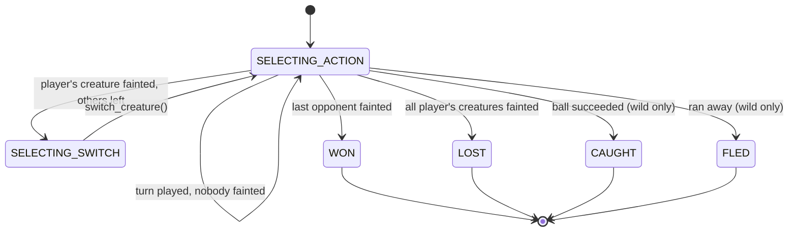

---

## 11. Testing

`python3 -m unittest discover tests` runs 215 tests in about a second, with no window needed.

| Test file | What it proves |
|---|---|
| `test_oop_pillars.py` | one test class per pillar |
| `test_bug_regressions.py` | each bug found in the code review stays fixed |
| `test_battle.py`, `test_battle_flow.py` | turns, catching, fleeing, switching, move learning, blackout |
| `test_trainers.py` | trainer/gym battles, SmartAI, line of sight, badges |
| `test_world.py`, `test_overworld.py` | maps, warps, entities; a reachability walk over the whole world |
| `test_story.py` | intro, name entry, starter choice, rival pick, locked route |
| `test_ui_screens.py` | no text overflows its box on any screen; save/continue; bag |
| `test_errors.py` | the exception hierarchy, damaged or missing saves, safe writes |
| `test_scene_rendering.py`, `test_asset_verification.py`, `test_battle_hud_and_components.py` | screens render headless; assets load; the model has no pygame imports |

---

## 12. Honest limitations

* **Two classes are still large:** `Battle` and `OverworldScene` (see SOLID above).
* **The renderer picks a sprite by entity class.** `MapRenderer.draw_entity` checks whether an entity is a `Character`, `Sign`, `StarterBall` or `ItemBall`. This is drawing code in the UI layer, kept there so the model stays free of pygame. A Visitor or a `sprite_kind` property would remove the check.
* **Trainers don't walk up to you.** They spot you, show "!", and the battle starts from where they stand.
* **Difficulty was tuned by simulation** (60–80 runs per starter, about 12 wild battles before the gym). Approximate win rates against WREN:
  * Charmander: about 90%.
  * Squirtle: about 80%.
  * Bulbasaur: needs a second creature, such as the rare Route 1 Pikachu (about 95% with one).
* **The creature sprites, names and fonts are from the existing assets**, used for a private classroom project.
