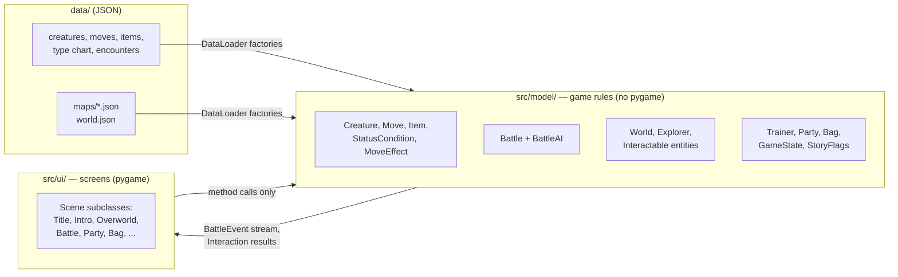
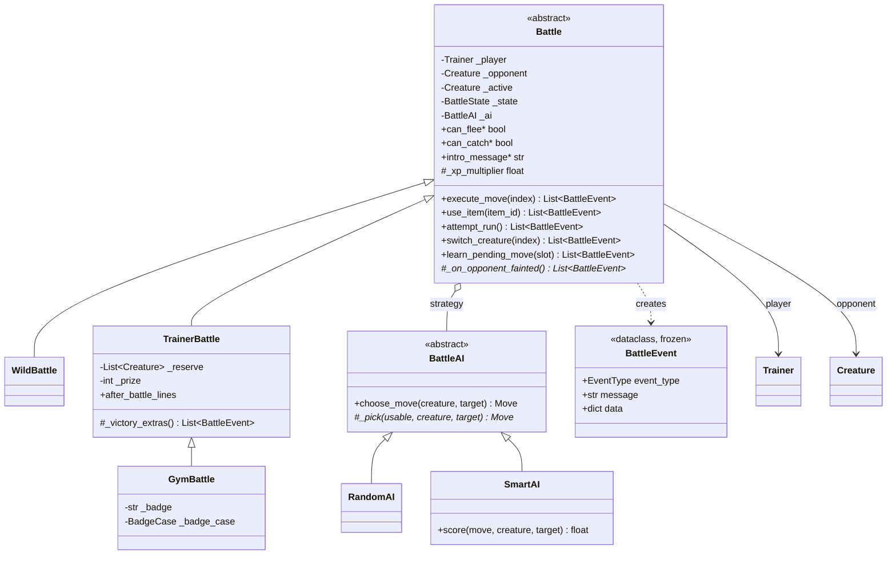
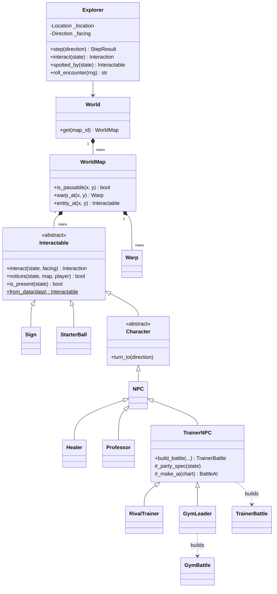
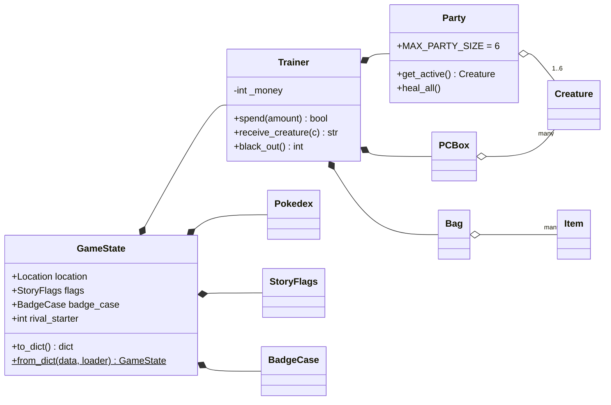

# Creature Collector — Object-Oriented Design

A small GBA-style creature-collecting game in Python and Pygame, built as an OOP project.
This document maps each of the four pillars (encapsulation, abstraction, inheritance and
polymorphism) to the exact classes and lines that demonstrate them. It also lists the
design patterns used and includes UML class diagrams.

Every reference below is a link to the line in the source.

---

## 1. Architecture at a glance



* **`src/model/`** holds every rule of the game and never imports pygame. A test enforces this:
  [test_model_layer_has_zero_pygame_imports](../tests/test_scene_rendering.py#L44).
* **`src/ui/`** only draws and handles input. It asks the model to do things and animates what the model reports back.
* **`data/`** holds the content: species, moves, items, the type chart, encounter tables and maps. Nothing is hard-coded in classes; `DataLoader` builds objects through factories.

---

## 2. Encapsulation

> Each object keeps its state private and exposes it read-only. State changes only through methods that enforce the rules.

| Class | Private state | Only changed through | Rule enforced |
|---|---|---|---|
| `Creature` | `_hp`, `_level`, `_xp`, `_moves`, `_status`, `_stat_stages` ([constructor](../src/model/creature.py#L56)) | [take_damage()](../src/model/creature.py#L228), [heal()](../src/model/creature.py#L236), [gain_xp()](../src/model/creature.py#L282), [learn_move()](../src/model/creature.py#L306), [apply_status()](../src/model/creature.py#L263) | HP stays between 0 and max; fainted creatures can't be healed, only revived; at most 4 moves; type immunities |
| `Move` | `_current_pp` | [use()](../src/model/move.py#L85), [restore_pp()](../src/model/move.py#L92) | PP never below 0 or above max |
| `Item` | `_quantity` | [consume()](../src/model/item.py#L76), [add_stock()](../src/model/item.py#L71) | stock can't go negative |
| `Bag` | `_items` dict | [add()](../src/model/bag.py#L30), [use()](../src/model/bag.py#L56) | stacks merge by id; empty stacks disappear |
| `Party` | `_creatures` list, exposed as a tuple ([creatures](../src/model/trainer.py#L16)) | [add()](../src/model/trainer.py#L50), [swap()](../src/model/trainer.py#L63) | at most 6 creatures |
| `Trainer` | `_money`, `_party`, `_bag`, `_pc` | [spend()](../src/model/trainer.py#L150), [earn()](../src/model/trainer.py#L147), [receive_creature()](../src/model/trainer.py#L164) | can't overspend; a full party sends new catches to the PC |
| `Pokedex` | `_seen`, `_caught` sets, exposed as frozensets | [register_caught()](../src/model/pokedex.py#L35) | catching also marks a species as seen |
| `Battle` | `_state`, `_active`, `_opponent` | [execute_move()](../src/model/battle.py#L153), [use_item()](../src/model/battle.py#L181), [switch_creature()](../src/model/battle.py#L242) | the turn order and faint rules can't be bypassed |

Proof in tests: [TestEncapsulation](../tests/test_oop_pillars.py#L27) checks, for example, that `creature.current_hp = 999` raises `AttributeError`.

---

## 3. Abstraction

> Abstract base classes define *what* something does; subclasses decide *how*. Callers depend only on the abstract interface.

| Abstract class | Abstract methods / hooks | Concrete subclasses |
|---|---|---|
| [Move](../src/model/move.py#L18) | `is_damaging()` | `PhysicalMove`, `SpecialMove`, `StatusMove` |
| [DamagingMove](../src/model/move.py#L122) | `attack_stat()`, `defense_stat()` | `PhysicalMove`, `SpecialMove` |
| [Item](../src/model/item.py#L22) | `can_use()`, `_apply()` | `HealingItem`, `StatusCureItem`, `ReviveItem`, `CatchBall` |
| [StatusCondition](../src/model/status.py#L15) | `applied_message()` (+ overridable `before_move`, `on_turn_end`, `modify_speed`) | `Burn`, `Poison`, `Paralysis`, `Sleep` |
| [MoveEffect](../src/model/move_effect.py#L17) | `apply()` (+ overridable `ai_score`) | `InflictStatus`, `HealUser`, `ChangeStat` |
| [Battle](../src/model/battle.py#L56) | `can_flee`, `can_catch`, `intro_message`, `_on_opponent_fainted()` | `WildBattle`, `TrainerBattle`, `GymBattle` |
| [BattleAI](../src/model/battle_ai.py#L15) | `_pick()` | `RandomAI`, `SmartAI` |
| [Interactable](../src/model/entities.py#L40) | `interact()`, `_from_data()` | `Sign`, `StarterBall`, `NPC`, `Healer`, `Professor`, `TrainerNPC`, `RivalTrainer`, `GymLeader` |
| [Scene](../src/ui/scene.py#L6) | `handle_event()`, `update()`, `draw()` | `TitleScene`, `IntroScene`, `OverworldScene`, `BattleScene`, `EvolutionScene`, `PartyScene`, `PokedexScene`, `BagScene`, `CardScene` |

Two larger abstractions hide whole subsystems:

* **`Battle`** hides the turn rules (speed order, accuracy, critical hits, status, faints, XP) behind a few calls such as `execute_move(i)`. It never draws anything. It returns immutable [BattleEvent](../src/model/events.py#L50) objects that the battle screen plays back.
* **`Explorer`** ([world.py](../src/model/world.py#L212)) hides the world rules: what blocks you, where doors lead, who is in front of you, whether a trainer sees you, and whether a wild creature appears. The overworld screen only animates the result.

Proof in tests: [TestAbstraction](../tests/test_oop_pillars.py#L82) checks that the abstract classes can't be instantiated.

---

## 4. Inheritance

> Subclasses reuse the parent's code and extend or specialise it, often calling `super()`.

```text
Move ─────────────┬─ DamagingMove ─┬─ PhysicalMove
                  │                └─ SpecialMove
                  └─ StatusMove
Item ─────────────┬─ HealingItem ─ StatusCureItem ─ ReviveItem ─ CatchBall
StatusCondition ──┬─ _ChipDamageStatus ─┬─ Burn
                  │                     └─ Poison
                  ├─ Paralysis
                  └─ Sleep
MoveEffect ───────┬─ InflictStatus ─ HealUser ─ ChangeStat
Battle ───────────┬─ WildBattle
                  └─ TrainerBattle ── GymBattle
BattleAI ─────────┬─ RandomAI ─ SmartAI
Interactable ─────┬─ Sign
                  ├─ StarterBall
                  └─ Character ── NPC ─┬─ Healer
                                       ├─ Professor
                                       └─ TrainerNPC ─┬─ RivalTrainer
                                                      └─ GymLeader
_CreatureCollection ─┬─ Party
                     └─ PCBox
Scene ────────────── 9 screens
```

Examples of reuse and extension:

* **Shared code in a middle class.** [_ChipDamageStatus](../src/model/status.py#L80) implements "lose 1/16 HP each turn" once, and `Burn` and `Poison` inherit it. [_CreatureCollection](../src/model/trainer.py#L9) gives `Party` and `PCBox` the same read-only view and iteration.
* **Extending with `super()`.**
  * [Healer.interact()](../src/model/entities.py#L205) reuses the NPC greeting, then heals the party.
  * [TrainerBattle.__init__](../src/model/battle.py#L518) reuses all of `Battle`'s setup and adds the trainer's reserve team.
  * [RivalTrainer._party_spec()](../src/model/entities.py#L365) adds the rival's starter to the trainer's normal team.
* **Three levels deep.** `GymBattle` → `TrainerBattle` → `Battle`. `GymBattle` only overrides [_victory_extras()](../src/model/battle.py#L584) to add a badge; everything else (turns, prize money, sending out the next creature) is inherited.

Proof in tests: [TestInheritance](../tests/test_oop_pillars.py#L91), [test_trainers.test_hierarchy](../tests/test_trainers.py#L61) and [test_world.test_hierarchy](../tests/test_world.py#L108).

---

## 5. Polymorphism

> The caller makes one call, and each class responds in its own way. The engine never asks "what kind of object is this?"

| Call site | One call… | …different behaviour per class |
|---|---|---|
| [Battle.calculate_damage](../src/model/battle.py#L294) | `move.attack_stat(user)` | `PhysicalMove` uses Attack, `SpecialMove` uses Sp. Atk |
| [Battle._execute_move_step](../src/model/battle.py#L358) | `status.before_move()` | `Paralysis` may skip the turn, `Sleep` counts down then wakes up, `Burn` does nothing |
| [Battle._end_of_turn](../src/model/battle.py#L411) | `status.on_turn_end()` | `Burn`/`Poison` deal damage, the others don't |
| [Battle._execute_move_step](../src/model/battle.py#L392) | `effect.apply()` | inflict a status, heal the user, or change a stat |
| [Battle.use_item](../src/model/battle.py#L190) | `item.use_in_battle(battle)` | potions heal your creature; [CatchBall](../src/model/item.py#L196) overrides it to throw itself at the opponent |
| [Battle.execute_move](../src/model/battle.py#L166) | `ai.choose_move()` | `RandomAI` picks any move; `SmartAI` scores them with the type chart |
| [SmartAI.score](../src/model/battle_ai.py#L55) | `effect.ai_score()` | a heal is worth more when hurt; a status is worthless on an already-afflicted target |
| [Battle._resolve_faints](../src/model/battle.py#L428) | `self._on_opponent_fainted()` | `WildBattle` ends the battle; `TrainerBattle` sends out the next creature or pays the prize |
| [Explorer.interact](../src/model/world.py#L281) | `entity.interact(state, facing)` | a sign shows text, an NPC turns and talks, the healer heals, the professor gives a gift, a starter ball offers its creature, a trainer starts a battle |
| [Explorer.spotted_by](../src/model/world.py#L287) | `entity.notices(...)` | `False` for everything except `TrainerNPC`, which checks its line of sight |
| [OverworldScene._start_trainer_battle](../src/ui/overworld_scene.py#L307) | `trainer.build_battle(...)` | `TrainerNPC` → `TrainerBattle` + `RandomAI`; `GymLeader` → `GymBattle` + `SmartAI`; `RivalTrainer` → its starter-led team |
| [BagScene](../src/ui/bag_scene.py#L80) | `item.usable_in_field` | `True` for potions; `CatchBall` overrides it to `False` |
| `engine.current_scene.update() / draw()` | `scene.draw(surface)` | each of the nine screens draws itself |

Proof in tests: [TestPolymorphism](../tests/test_oop_pillars.py#L114).

---

## 6. Design patterns used

| Pattern | Where |
|---|---|
| **Factory** | [MoveFactory](../src/model/move.py#L167), [ItemFactory](../src/model/item.py#L199), [CreatureFactory](../src/model/creature.py#L371), `DataLoader` |
| **Self-registering factory** (`__init_subclass__`) | [Interactable.from_data()](../src/model/entities.py#L50) and [StatusCondition.create()](../src/model/status.py#L27): a new subclass registers itself just by being defined |
| **Factory Method** | [TrainerNPC.build_battle()](../src/model/entities.py#L327) with the overridable `_battle_class()`, `_make_ai()` and `_party_spec()` |
| **Template Method** | [Item.use()](../src/model/item.py#L98) (check → consume → `_apply()`); `Battle`'s turn calls the hooks `_on_opponent_fainted()`, `_xp_multiplier` and `_victory_extras()` |
| **Strategy** | `BattleAI` (`RandomAI` / `SmartAI`) plugged into a `Battle` |
| **State** | [BattleState](../src/model/battle.py#L43) enum; every screen's `mode` / `sub_state` |
| **Observer-like event stream** | `Battle` returns `BattleEvent`s; `BattleScene` plays them back without knowing the rules |
| **Composition** | `GameState` *has* a `Trainer`, `Pokedex`, `StoryFlags`, `BadgeCase`; `Trainer` *has* a `Party`, `Bag` and `PCBox`; `Party` *has* `Creature`s, which *have* `Move`s and a `StatusCondition` |

---

## 7. UML class diagrams

### 7.1 Battles



### 7.2 Creatures, moves, effects, statuses and items


### 7.3 World and map entities



### 7.4 Player state (composition)



---

## 8. Testing

`python3 -m unittest discover tests` runs 136 tests in about a second, with no window needed.

| Test file | What it proves |
|---|---|
| `test_oop_pillars.py` | one test class per pillar |
| `test_bug_regressions.py` | each bug found in the code review stays fixed |
| `test_battle.py`, `test_battle_flow.py` | turns, catching, fleeing, switching, move learning, blackout |
| `test_trainers.py` | trainer/gym battles, SmartAI, line of sight, badges |
| `test_world.py`, `test_overworld.py` | maps, warps, entities; a reachability walk over the whole world |
| `test_story.py` | intro, name entry, starter choice, rival pick, locked route |
| `test_ui_screens.py` | no text overflows its box on any screen; save/continue; bag |
| `test_scene_rendering.py`, `test_asset_verification.py`, `test_battle_hud_and_components.py` | screens render headless; assets load; the model has no pygame imports |

---

## 9. Honest limitations

* **The renderer picks a sprite by entity class.** `MapRenderer.draw_entity` checks whether an entity is a `Character`, `Sign` or `StarterBall`. This is drawing code in the UI layer, kept there so the model stays free of pygame. A Visitor or a `sprite_kind` property would remove the check.
* **Trainers don't walk up to you.** They spot you, show "!", and the battle starts from where they stand.
* **Difficulty was tuned by simulation** (60–80 runs per starter, about 12 wild battles before the gym). Approximate win rates against WREN:
  * Charmander: about 90%.
  * Squirtle: about 80%.
  * Bulbasaur: needs a second creature, such as the rare Route 1 Pikachu (about 95% with one).
* **The creature sprites, names and fonts are from the existing assets**, used for a private classroom project.
